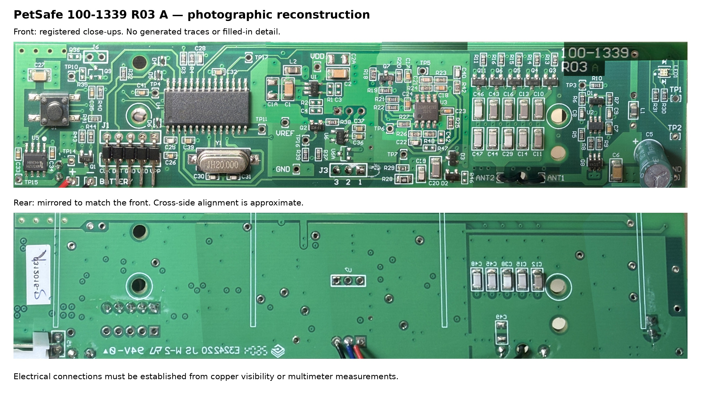

# PetSafe PCB reverse engineering

**PetSafe PPA19-16811 · 100-1339 R03 A · schematic v0.9.52**

One A3 landscape main-board schematic, reconstructed from original photographs and owner measurements. 82 modeled net partitions agree with KiCad; device functions and physical-evidence coverage remain qualified. **There is no routed reproduction PCB.**

## Current schematic

[PDF](output/pdf/PetSafe_single_sheet.pdf) · [Editable KiCad project](schematic/PetSafe_1001339.kicad_pro) · [Schematic](schematic/PetSafe_1001339.kicad_sch) · [Local zoomable overview](index.html)

[](output/pdf/PetSafe_single_sheet.pdf)

All **44 starred capacitor values are estimates**, preserved with their basis and proposed ratings. C5 and the recorded inductor measurements remain unchanged. The **U6/U6A regulator-output ERC conflict is deliberately retained**; the new owner-supported receiver joins resolve the four earlier receiver findings without exclusions. U3 pin3 joins VREF; C19 lower joins C20 lower/R28 right/D2.R; C20 upper joins R42 lower/D3.S. File consistency is not proof of complete hardware connectivity.

## Proposed external button bridge

The native drawing retains the USB-powered ESP32-C6 SuperMini, the owner's 2N3904 and 4.7 kΩ / 100 kΩ resistors in parallel with S1. The owner is preparing the perfboard prototype with a separate LM2596 battery converter; external-power qualification remains open. [Add-on BOM and wiring](docs/BUTTON_BRIDGE.md) · [Firmware: local web control, HTTP API and flashing](firmware/button_bridge/README.md). These four external parts are excluded from the factory-board BOM/PCB. TPL5111/PIR wake is deferred; no carrier PCB is included.

## Actual physical PCB

[](photos/two_sides_overview.jpg)

These mosaics contain original photographic pixels. The rear is **mirrored and approximately registered** to the front; it is a comparison aid, not a hidden-layer reconstruction. [Readable rear orientation](photos/back_readable.jpg) · [Original-photo atlas](photo-atlas-v01.html) · [Originals](photos/originals) · [Via/photo viewer](docs/VIA_REVIEW.html).

## Open items

The [full Markdown register](docs/OPEN_ITEMS.md) and [HTML checklist](docs/FINISHING_CHECKLIST.html) reflect [remaining_work.json](evidence/remaining_work.json). The duplicate completion PDF is retired; use the HTML checklist for current status.

| ID | Area | Category |
|---|---|---|
| [E03](docs/OPEN_ITEMS.md#e03) | RF supply and Q8 drive | Device function/rating; operating behaviour |
| [E04](docs/OPEN_ITEMS.md#e04) | Antenna and tuning-cell topology | Physical pin mapping; device function/rating |
| [E07](docs/OPEN_ITEMS.md#e07) | PIR: Q2 behavior and operating supply | Device function/rating; operating behaviour |
| [E08](docs/OPEN_ITEMS.md#e08) | Receiver and Q7 operating behavior | Device function/rating; operating behaviour |
| [E09](docs/OPEN_ITEMS.md#e09) | Supply voltages and Q1 control | Device function/rating; operating behaviour |
| [E10](docs/OPEN_ITEMS.md#e10) | D6 breakdown and ICSP compatibility | Device function/rating |
| [I01](docs/OPEN_ITEMS.md#i01) | Candidate device identities and pin roles | Physical pin mapping; device function/rating |
| [V01](docs/OPEN_ITEMS.md#v01) | Capacitor values and passive ratings | Reproduction/package (values and passive ratings) |
| [M01](docs/OPEN_ITEMS.md#m01) | LED footprint and mechanical qualification | Reproduction/package |
| [E11](docs/OPEN_ITEMS.md#e11) | Inherited copper joins without independent closure | Copper connection; evidence coverage |
| [A01](docs/OPEN_ITEMS.md#a01) | External ESP32 button bridge: assembly qualification | Proposed modification; separate from reconstruction |

TP11/TP17 hidden continuations remain a separately documented reconstruction boundary. No pending readings. RX-3 remains deferred. Owner is preparing the perfboard button bridge; local web/HTTP firmware is provided for later commissioning. LM2596 internal-power qualification, SuperMini input/isolation and owned-part lead order remain open. TPL5111/PIR wake is deferred. Package geometry, routing/stackup, external assemblies and firmware remain prerequisites for a working reproduction.

## Evidence and rebuild

[Independent physical-evidence audit](docs/TOPOLOGY_AUDIT.md) · [Current circuit interpretation](docs/RECONSTRUCTION.md) · [Measurements and negative results](docs/MEASUREMENTS.md) · [Capacitor proposals](docs/CAPACITOR_VALUE_REVIEW.html) · [Native validation](evidence/validation.json) · [Investigation history](docs/history/README.md)

Use installed KiCad 10 (checked with 10.0.5), PowerShell and [Python dependencies](tools/requirements.txt):

```powershell
$env:PYTHONUTF8 = '1'
./tools/build.ps1 -Python python
./tools/refresh_review.ps1 -Python python
```

The normal build exports/checks the current native file. The owner's redrawn layout is now the checked baseline; `-Regenerate` restores that complete layout from the synchronized native template, including its wires and comments. It no longer runs the old placement router. [The baseline review](evidence/owner_redraw_baseline_v0951.json) records the electrical fixes, requested layout moves and comment review; the incoming file is archived there. [The physical crosswalk](evidence/pin_crosswalk.json) preserves original pad labels. Original photos and raw results are not rewritten when interpretations change.

[Original architect review: PR #1](https://github.com/kerby2000/PetSafe-PCB/pull/1) is merged. Later corrections are reviewed in follow-up pull requests.
