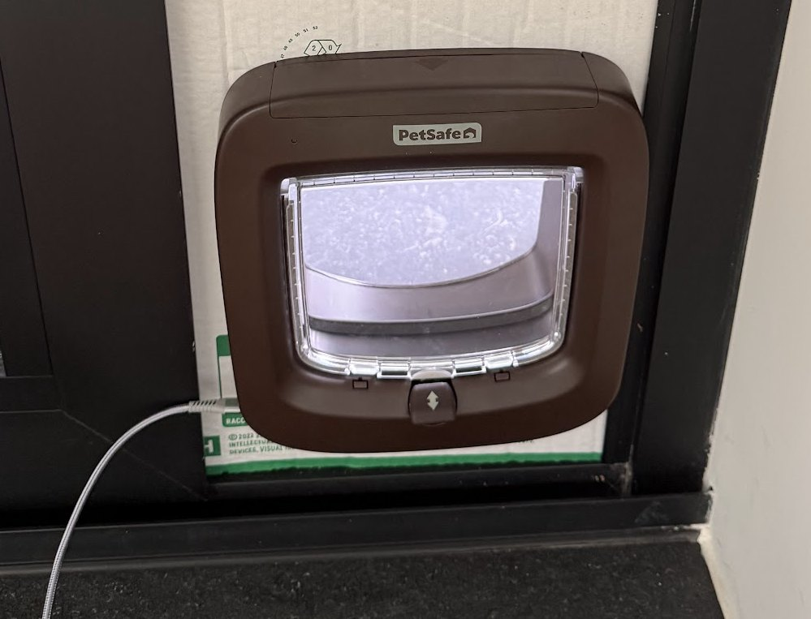

# PetSafe microchip cat-flap reverse engineering and remote-button retrofit

*Owner's installed prototype in a temporary cardboard fit-test insert. This is not a permanent weatherproof installation.*

An **ESP32-C6 SuperMini and one transistor operate the original PetSafe button remotely** from a local web page or authenticated HTTP API. The owner reports successful remote button/motor operation and installation. The original S1 button, PIC controller and motor driver remain in use.

**PetSafe PPA19-16811 · main board 100-1339 R03 A · firmware 0.1.0 · schematic v0.9.52**

## What works and what remains

| Status | Scope |
|---|---|
| Demonstrated | Owner-reported remote button press, motor response/delayed return and installation; firmware flash/boot and authenticated HTTP status checks recorded. |
| Planned | Camera/prey recognition and automatic admission. Neither is implemented or demonstrated. |
| Unknown | Independent OPEN/CLOSE state and latch position; the API reports button-output status, not door state. Power margins, failure behavior and long-term reliability remain qualified. |
| Reconstruction | One A3 landscape schematic; 82 modeled factory net partitions agree with KiCad. All **44 starred capacitor values are estimates**. **No routed reproduction PCB exists.** |

This is a working prototype, not a finished prey detector, secure access-control product or exact factory schematic. A press can toggle the current mode; a lost response must not trigger a fresh automatic retry.

## Short demo

[Watch the silent bench excerpt](photos/publication/remote-button-bench-excerpt.mp4) — the final 11.7 seconds of the owner's bench demonstration, following an off-screen remote command. It shows the original mechanism, not AI recognition or the final installed power routing. The full clip stays local because it includes a private chat on the monitor; [media details and release preparation](docs/PUBLICATION.md#demo).

## Build the minimal retrofit

| Quantity | Part | Connection |
|---|---|---|
| 1 | ESP32-C6 SuperMini | GPIO3 drives the base resistor; GND joins PetSafe GND. |
| 1 | 2N3904 NPN | Collector → H_BUTTON/S1 pin 2; emitter → GND/S1 pin 1. Confirm the actual part's lead order. |
| 1 | 4.7 kΩ resistor | GPIO3 → transistor base. |
| 1 | 100 kΩ resistor | Base → emitter, on the transistor side of the 4.7 kΩ resistor. |
| As needed | Insulated wire, isolated-pad perfboard and mounting insulation | Preserve the original button and factory circuitry. |

[Wiring, transistor pin mapping and installation photos](docs/BUTTON_BRIDGE.md) · [Owner-confirmed USB power arrangement and its limits](docs/BUTTON_BRIDGE.md#current-wired-power-direction)

Installed power: USB-C into the ESP, its 5V header to PetSafe battery-positive, common ground, **AA cells removed**, external converter output disconnected. The ESP uses its onboard 3.3 V regulator. This records the owner's build; it does not qualify the header/trace for motor current or establish source isolation. The native schematic retains the separate-positive-supply reference drawing. Do not parallel external power with alkaline cells or two regulator outputs.

## Firmware setup and use

Follow the [ESP-IDF v6.0.2 configuration/build instructions](firmware/button_bridge/README.md#build-and-configure), then the [first-flash instructions](firmware/button_bridge/README.md#flash-or-update-a-prototype). Configure Wi-Fi and a private token locally; configured binaries contain credentials and must not be published.

The [local web page and HTTP API](firmware/button_bridge/README.md#http-api) issue an authenticated 200 ms GPIO3 pulse with duplicate protection and a five-second cooldown. HIGH presses, LOW releases. Keep this HTTP control service on a trusted local network; do not expose it to the internet. Camera decisions can later use the existing client, but there is no camera integration in this version. TPL5111/PIR wake is deferred.

## Reconstructed schematic and evidence

[PDF](output/pdf/PetSafe_single_sheet.pdf) · [Editable KiCad project](schematic/PetSafe_1001339.kicad_pro) · [Schematic](schematic/PetSafe_1001339.kicad_sch) · [Existing investigation viewer](index.html)

The **U6/U6A regulator-output ERC conflict is deliberately retained**. File consistency is not proof of every physical connection. Capacitor estimates, observed values, original photographs, measurements and negative results remain distinct and preserved.

[Original-photo atlas](photo-atlas-v01.html) · [Front/rear PCB mosaics](photos/two_sides_overview.jpg) · [Via/photo viewer](docs/VIA_REVIEW.html) · [Physical-evidence audit](docs/TOPOLOGY_AUDIT.md) · [Current interpretation](docs/RECONSTRUCTION.md) · [Measurements](docs/MEASUREMENTS.md) · [Capacitor estimates](docs/CAPACITOR_VALUE_REVIEW.html)

## Remaining work

The [existing register](docs/OPEN_ITEMS.md) and [HTML checklist](docs/FINISHING_CHECKLIST.html) both use [remaining_work.json](evidence/remaining_work.json). There is no second checklist or completion PDF.

| ID | Area | Category |
|---|---|---|
| [E03](docs/OPEN_ITEMS.md#e03) | RF supply and Q8 drive | Device function/rating; operating behaviour |
| [E04](docs/OPEN_ITEMS.md#e04) | Antenna and tuning-cell topology | Physical pin mapping; device function/rating |
| [E07](docs/OPEN_ITEMS.md#e07) | PIR: Q2 behavior and operating supply | Device function/rating; operating behaviour |
| [E08](docs/OPEN_ITEMS.md#e08) | Receiver and Q7 operating behavior | Device function/rating; operating behaviour |
| [E09](docs/OPEN_ITEMS.md#e09) | Supply voltages and Q1 control | Device function/rating; operating behaviour |
| [E10](docs/OPEN_ITEMS.md#e10) | D6 breakdown and ICSP compatibility | Device function/rating |
| [I01](docs/OPEN_ITEMS.md#i01) | Candidate device identities and pin roles | Physical pin mapping; device function/rating |
| [V01](docs/OPEN_ITEMS.md#v01) | Capacitor values and passive ratings | Reproduction/package (values and passive ratings) |
| [M01](docs/OPEN_ITEMS.md#m01) | LED footprint and mechanical qualification | Reproduction/package |
| [E11](docs/OPEN_ITEMS.md#e11) | Inherited copper joins without independent closure | Copper connection; evidence coverage |
| [A01](docs/OPEN_ITEMS.md#a01) | External ESP32 button bridge: camera and power qualification | Working external prototype; separate from reconstruction |

No pending readings. RX-3 remains deferred. Remote button/motor operation and installation are owner-confirmed. USB-C powers the ESP; its 5V header feeds PetSafe battery-positive with cells removed and converter output disconnected. Power margins remain unverified. Camera/prey recognition and automatic admission are not implemented. TPL5111/PIR wake is deferred. TP11/TP17 hidden continuations remain an explicit reconstruction boundary. Package geometry, routing/stackup, external assemblies and original firmware remain prerequisites for a factory-board reproduction.

## Rebuild and publication

[Ordinary native-project use versus optional audit regeneration](docs/REBUILD.md) · [Native validation](evidence/validation.json) · [Source/provenance register](docs/SOURCES.md) · [Licensing proposal and draft prototype release](docs/PUBLICATION.md) · [Investigation history](docs/history/README.md)

There is no top-level project license yet; public visibility is not a uniform open-source license. Third-party notices and the STEP model's noncommercial terms remain in force. Licensing, any release tag and Pages hosting await owner approval. No release or hosted control service is published by this preparation.

**Unofficial independent project; not affiliated with or endorsed by PetSafe or Radio Systems Corporation.**
