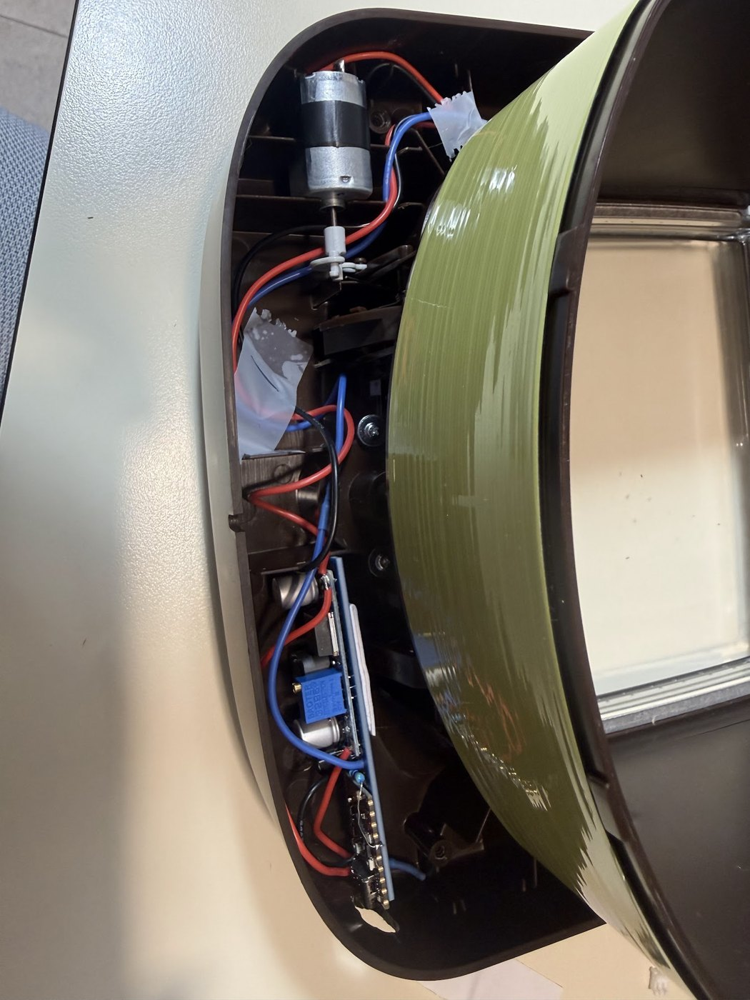
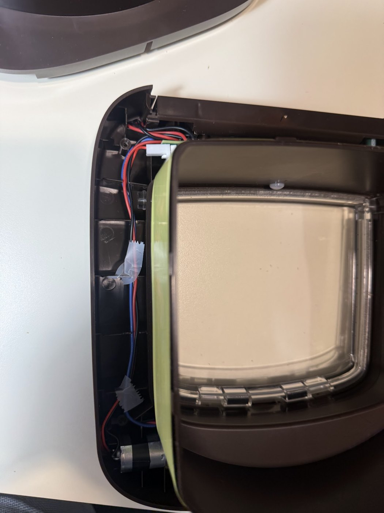
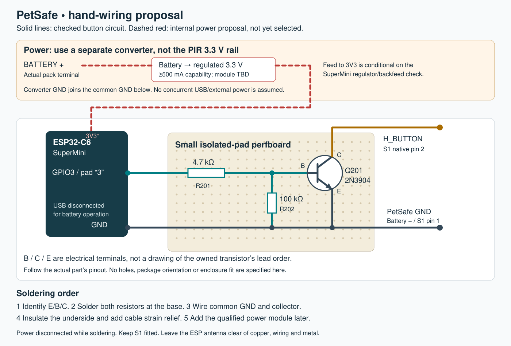

# External ESP32 button bridge — working prototype

**Working prototype:** the owner reports successful remote button/motor operation with firmware v0.1.0 and installation in the flap. This is a short button press through the original controller, without independently verified OPEN/CLOSE state or latch feedback. Camera/prey recognition and automatic admission are the next phase and are not implemented. The [existing A01 register](OPEN_ITEMS.md#a01) retains commissioning evidence and power qualifications. [Short silent bench excerpt](../photos/publication/remote-button-bench-excerpt.mp4). The native schematic remains the separate-positive-supply baseline; the owner-confirmed installed USB route is documented below without changing factory connections.

The USB-powered **ESP32-C6 SuperMini** briefly pulls **H_BUTTON** to **PetSafe GND** through the owner's **2N3904 NPN**. This is electrically in parallel with S1. S1, R40/R41/C35, the factory PIC firmware and the motor wiring are unchanged. No trace cuts are required.

The dashed block on the [A3 schematic](../output/pdf/PetSafe_single_sheet.pdf) contains only the external addition. Its four parts are excluded from the factory-board BOM and PCB. The original external L101 antenna winding remains separate too. The [firmware](../firmware/button_bridge/README.md) is a separate add-on; no carrier PCB layout is provided.

## Add-on BOM

| Ref | Part | Symbol / footprint | Qualification |
|---|---|---|---|
| U201 | Owner's ESP32-C6 SuperMini, USB powered | TrailCurrent ESP32-C6-SuperMini / ESP32-C6-SuperMini_TH | Owned chip identified as ESP32-C6FH4/4 MB and prototype operates; imported footprint remains a candidate for any manufactured carrier. |
| Q201 | Owner's 2N3904 NPN | Stock `Transistor_BJT:2N3904` / `Package_TO_SOT_THT:TO-92_Inline` | **Owned part's manufacturer and actual E/B/C lead order pending.** |
| R201 | 4.7 kΩ, ordinary 1/4 W resistor | Stock `Device:R` / axial DIN0207, 7.62 mm pitch | Series base resistor. |
| R202 | 100 kΩ, ordinary 1/4 W resistor | Stock `Device:R` / axial DIN0207, 7.62 mm pitch | Base-to-emitter pull-down, after R201. |

Stock Q201 numbering is **1 = emitter, 2 = base, 3 = collector**, consistent with the [onsemi 2N3903/2N3904 datasheet](https://www.onsemi.com/pub/Collateral/2N3903-D.PDF). The owner's maker/package has not been identified, so do not infer the physical left-to-right lead order from the part name alone. The footprint is a reference for an external TO-92 part, not a replacement factory part.

## Physical wiring

| From | To |
|---|---|
| SuperMini pad labelled **3 / GPIO3**, U201 library header pin **6** | R201, 4.7 kΩ, GPIO end (native pin 2) |
| Other end of R201 (native pin 1) | Q201 **base**, stock pin 2 |
| Q201 base | R202, 100 kΩ, then Q201 emitter |
| Q201 **collector**, stock pin 3 | **H_BUTTON / S1 native pin 2** |
| Q201 **emitter**, stock pin 1 | **PetSafe GND / S1 native pin 1** |
| SuperMini **GND**, U201 library header pin **12** | Same PetSafe GND / emitter junction |
| USB cable | SuperMini's own USB connector |

Use board silk labels to identify the SuperMini pads; **library header number 6 is GPIO3, not GPIO6**. The selected library places GPIO3 sixth down the left row and GND second down the right row, viewed from the component side with USB at the top. Verify that orientation against the owned board. S1's measured physical contact groups are TL/TR → GND (native pin 1), BL/BR → H_BUTTON (native pin 2), in the existing S1 photo orientation; [original contact evidence](../evidence/s1_contact_results_20261009.json) remains unchanged.

The supplied STEP model's [labelled top view](esp32-c6-owner-top.png) agrees with these two selected pads. It is a model view, not a photograph confirming the owned board.

The **native schematic baseline** keeps ESP32 5V/3V3 separate from PetSafe positive rails, with common ground. The owner-confirmed installed shared USB route is documented below; it has not been incorporated into the native schematic. Do not connect ESP 3V3 to PetSafe BATTERY+, VSYS, VDD or H_BUTTON. Unused SuperMini header pins have explicit NC marks in this proposed external circuit; USB supplies the board internally, so an unused 5V header is not a claim that the module is unpowered. Disconnect the PetSafe programmer for commissioning.

## GPIO and press behavior

**GPIO_BTN is GPIO3.** Espressif's [ESP32-C6 datasheet](https://www.espressif.com/sites/default/files/documentation/esp32-c6_datasheet_en.pdf), Tables 2-2 and 2-5 and Section 3, identifies GPIO3 as an output-capable ordinary GPIO, input-enabled at/after reset without a listed weak pull-up. It is not one of the boot strapping pins, USB pins, UART0 pins or default JTAG pins. R202 pulls the base low while the GPIO is high impedance. This is the documented basis for selecting it; the owned SuperMini has now booted this firmware and reported an idle/no-fault output over HTTP before owner tests. That software status is not an independently measured pin waveform.

- **HIGH = press; LOW = release.** Firmware commands **200 ms HIGH**; the owner confirms the expected motor/button response. Exact physical pulse width and the accepted duration range have not been measured.
- Firmware v0.1.0 initializes the output latch LOW before enabling output and uses an independent GPTimer interrupt for release. It supplies authenticated 200 ms presses, a five-second cooldown and duplicate/stale-command rejection. Flashing, normal boot/API status and owner remote-button operation have been checked. Physical release waveforms through all resets, Wi-Fi loss and power transitions remain uncharacterized.
- A continuous HIGH is a held button, **not “keep unlocked.”** The existing button changes the door's mode; this is not separate OPEN/CLOSE control and supplies no latch feedback.
- A firmware failure that holds HIGH is not corrected by the 100 kΩ resistor. This minimal circuit does not guarantee release or relocking after an ESP32 failure.

At a nominal 3.3 V GPIO and about 0.7 V base-emitter drop, R201 supplies about 0.55 mA, with about 7 µA through R202. The recorded 10 kΩ R40 pull-up presents a sub-mA load at the board's reported supply levels. These are design estimates, not measurements of the new bridge.

## Library and supplied STEP model

The owner-selected [TrailCurrentKiCADLibraries](https://github.com/trailcurrentoss/TrailCurrentKiCADLibraries/tree/fb8b1725b9de036cbeba4093080f277374322d15) is pinned at `fb8b1725b9de036cbeba4093080f277374322d15`. Only its SuperMini symbol and through-hole footprint are imported, registered in project-local library tables. No global library installation is required. The symbol pins and graphics are unchanged. Bare-chip distributor part numbers from upstream are not used as procurement claims for the complete development board. Upstream's [MIT licence](../schematic/TrailCurrent-LICENSE.txt) is retained.

The owner's `esp32-c6-supermini-1.snapshot.14.zip` supplies the [STEP model without header pins](../schematic/ButtonBridge.3dshapes/ESP32-C6-SuperMini-owner.step), linked from the footprint with a portable `${KIPRJMOD}` path. Its separate [CC BY-NC 4.0 licence notice](../schematic/ButtonBridge.3dshapes/OWNER-MODEL-LICENSE.jpg) is retained; it is **not** relicensed under the library's MIT terms. Original STEP contents and file metadata are unchanged.


Rendered from the supplied STEP geometry. Colours are illustrative; this is not a photograph or a proposed carrier PCB.

The model's hole rows are approximately 15.24 mm apart with 2.54 mm pitch, consistent with the selected footprint. The model is centered using offset (9, 12.9865, 0) mm and a 180° Z rotation so the USB end and hole rows align in KiCad's 3D coordinates. Its 18 × 26 mm body differs slightly from the footprint's 18.2 × 26.2 mm outline. This checks the provided assets against each other, **not the owned board, pad numbering, header stand-off or enclosure clearance**. No carrier PCB has been created.

## Assembly record and remaining qualifications

Imported asset integrity uses exact LF bytes for the project symbol, footprint and STEP, enforced by `.gitattributes` even on Windows checkouts. The live hashes in `evidence/reconstruction.json` match Git's committed blobs. The separate `original_import_sha256` record retains the pre-Git CRLF digests; upstream library and owner ZIP digests are unchanged. Line-ending normalization does not change pad geometry, symbol pins, the STEP transform or source/licensing evidence.

No new reconstruction measurements are requested. Basic assembly and remote operation are complete by owner report. Exact maker/lead-order documentation, hidden solder joints, power margins and failure/restart behavior remain qualified in **A01** in the [existing open-item register](OPEN_ITEMS.md#a01).

The owner's original [overview](../photos/originals/owner_bridge_layout_20261018_overview.png) and [close-up](../photos/originals/owner_bridge_layout_20261018_closeup.png) show placement **before soldering**, not verified final wiring. The pictured compact converter is not positively identified as the earlier LM2596/HW-411 proposal. The apparent GPIO2 placement in the preliminary image was flagged before soldering; the unchanged firmware uses GPIO3. The later functional result is owner evidence. The installation photographs below show mechanical placement, not every solder joint.

## Current wired-power direction

**Owner-confirmed installed wiring, 2026-10-23.** All AA cells are removed. USB-C supplies nominal 5 V to the ESP32-C6 SuperMini. Its **5V header pad** feeds PetSafe's actual battery-positive terminal. The ESP's onboard regulator makes its own 3.3 V; the external converter output is disconnected. The converter's exact model and remaining input connection have not been confirmed, so neither is assigned a power-conversion role here.

```text
USB-C 5 V supply
  │
  └── ESP32-C6 SuperMini USB-C input
        ├── onboard regulator → ESP32 3.3 V
        └── 5V header pad ─────→ PetSafe BATTERY+ terminal

USB GND / ESP GND ─────────────→ PetSafe GND / battery-negative
                                and Q201 emitter / S1 pin 1

External converter output: DISCONNECTED
AA cells: REMOVED
Source-isolation circuitry: not established
```

This records the owner's arrangement; it does **not** qualify the SuperMini's USB-to-5V path for motor current, establish reverse-current isolation, or measure supply sag/transients. Nominal 5 V is owner-described, not a new meter result. Do not connect a live external supply across fitted alkaline cells, join the converter output to the ESP's 3V3, or parallel regulator outputs. A USB supply's current label alone does not establish header/trace capacity. No independent battery or second positive supply is connected in the confirmed arrangement. The native schematic still shows the separate-positive-supply reference circuit; this publication PR does not change it.

### Installed placement



The add-on/perfboard sits along the inner case wall beside the original mechanism. The converter remains physically present; appearance does not establish its model or hidden connections. Tape is visible over some wire runs, but the underside insulation, solder-side joints and secure attachment are not fully visible. This photo does not certify clearance through the full motor/cam movement.



Wire routing follows the case wall and passes near the motor. Tape holds parts of the run; no verified cable gland or engineered strain relief is established by this view. Keep wires and exposed metal clear of the motor/cam and moving latch when assembling another unit. The photographs document this prototype, not a proven weatherproof or production installation. The cardboard panel in the README is a **temporary fit-test insert**.

Camera tests are the next functional phase once the camera is available; no reconstruction measurements are pending.

## Earlier battery-converter option and soldering reference

The existing model supplies the PIR as follows:

`BATTERY+ → Q1/VSYS → L2 → U1 (4.5 V) → R37 (22 Ω) → U6 (3.3 V) → J3.1/PIR`

The reported 6.3 V battery/VSYS, 4.5 V VDD and 3.3 V PIR readings are existing evidence. U6 remains the S-812C33AMC candidate, not a newly confirmed identification. Its [manufacturer data](https://www.ablic.com/en/doc/datasheet/voltage_regulator/S812C_E.pdf) specifies the 3.3 V variant's output-current capability in the tens of milliamps, under stated input conditions. That is not spare current available on this board.

Even without relying on the candidate identity, **R37 makes this branch unsuitable**: 50 mA through 22 Ω drops 1.1 V, leaving only about 3.4 V at U6 from the reported 4.5 V input, before U6's own dropout. The PIR already shares this path. Espressif [recommends a 3.3 V supply capable of at least 500 mA](https://docs.espressif.com/projects/esp-hardware-design-guidelines/en/latest/esp32c6/schematic-checklist.html#power-supply); its [datasheet, Table 5-7](https://www.espressif.com/sites/default/files/documentation/esp32-c6_datasheet_en.pdf), lists hundreds of milliamps in Wi-Fi transmit states. 500 mA is a supply-design requirement, not a claim of continuous consumption. A buffer capacitor alone does not establish a sufficient sustained supply.

The internal-power alternative is **a separate 3.3 V converter fed from the actual battery terminals**, sharing battery negative/GND. It leaves the factory 3.3 V and 4.5 V rails unloaded by the ESP32. Select a module for the fresh-to-depleted four-AA voltage range, at least 500 mA output capability with margin, and low idle current. A fixed 3.3 V buck such as [Pololu D24V10F3](https://www.pololu.com/product/2830) illustrates the required class; its 1 A rating is conditional on input voltage/thermal limits, and regulation near battery depletion depends on dropout. It is only a specification example, not an added or purchased part; prefer a suitable owned module once identified. Its lack of reverse-input protection must be accommodated if selected.

A nominal “5 V to 3.3 V” module is not automatically rated for the measured 6.3 V pack or fresh batteries: verify its full input range, output capability and dropout before connecting it. Do not apply the reported 6.3 V battery directly to either SuperMini 3V3 or its 5V header. The supplied SuperMini library/STEP do not establish its onboard regulator circuit. Before choosing direct 3V3 injection, confirm that board variant permits it and how its regulator behaves under reverse bias. The alternative is a suitable battery-to-5V converter feeding the board's normal input. No simultaneous USB/external-power operation is assumed: a removable power link and a verified isolation arrangement belong in the final choice. **The diagram's dashed power path is a proposal, not an instruction to energize an unqualified board.**



Use a small **2.54 mm isolated-pad perfboard** to support the transistor and resistors. A roughly 30 × 40 mm piece is a starting size, subject to enclosure clearance; mount the SuperMini beside it or in sockets with its antenna end overhanging the support. This drawing is a connection guide, not a drilled-board layout or a physical E/B/C lead-order drawing.

1. Remove batteries and USB before soldering. Identify the owned transistor's E/B/C leads from its actual manufacturer's pinout; keep each lead on a separate pad.
2. Solder **4.7 kΩ from GPIO3 to base**. Solder **100 kΩ directly from that base junction to emitter**. The 100 kΩ must be on the transistor side of the 4.7 kΩ.
3. Run an insulated wire from **collector to H_BUTTON/S1 pin 2**, using the established S1 lower contact group in the original photo orientation. Run **emitter and SuperMini GND to PetSafe GND**, preferably the battery-negative/GND solder point for the shared power return. The manual button remains fitted.
4. Reserve separate red/black battery leads for the eventual converter. Use short stranded wires, approximately 24–26 AWG for power and 26–28 AWG for the button signal, with a labelled removable connector. Keep the converter and its wiring away from the RFID receive/tuning area and the ESP antenna.
5. Insulate the perfboard underside and exposed component leads; add strain relief so cable movement does not pull on S1's pads. Maintain clearance from the motor and moving latch. Check solder joints for accidental shorts as part of assembly, not as a repeated reconstruction measurement campaign.

The earlier battery-powered proposal needs **three connections to PetSafe: BATTERY+, GND and H_BUTTON**. LM2596/HW-411 was the candidate for the converter block labelled TBD in the historical illustration; the later compact photographed module has not been identified, and wired USB power is now preferred. [TI specifies 4.5 V minimum operating input](https://www.ti.com/lit/ds/symlink/lm2596.pdf); reliable 3.3 V output at low battery and Wi-Fi peaks is not guaranteed by the listing. Set its output to 3.30 V before connecting the ESP. The current firmware does not switch this module off, so its idle draw remains part of the prototype battery budget. The transistor wiring can be assembled independently with power disconnected.

Wi-Fi uses the existing router and is the owner's preferred starting point. Keeping it reachable requires periodic radio activity; deep sleep cannot receive a spontaneous Wi-Fi command, while connected modem/light-sleep modes trade latency against consumption ([Espressif sleep modes](https://docs.espressif.com/projects/esp-idf/en/latest/esp32c6/api-reference/system/sleep_modes.html)). Zigbee sleepy end devices can poll a powered parent for queued messages; this offers a different power/latency tradeoff but requires a coordinator and appropriate firmware ([Espressif Zigbee sleepy-device example](https://github.com/espressif/esp-zigbee-sdk/tree/main/examples/sleepy_devices/light_sleep_end_device)). Neither protocol removes the need for a supply able to handle radio current peaks. Battery life has not been measured for this SuperMini or proposed firmware.
