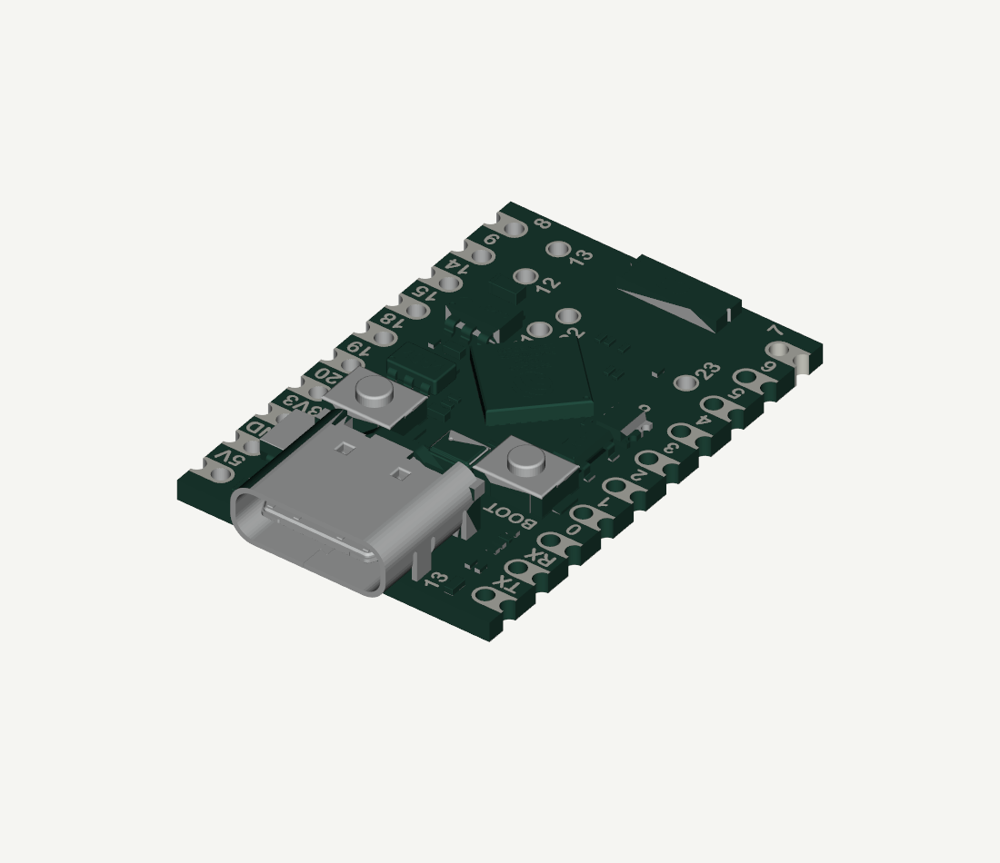

# External ESP32 button bridge — proposed modification

The USB-powered **ESP32-C6 SuperMini** briefly pulls **H_BUTTON** to **PetSafe GND** through the owner's **2N3904 NPN**. This is electrically in parallel with S1. S1, R40/R41/C35, the factory PIC firmware and the motor wiring are unchanged. No trace cuts are required.

The dashed block on the [A3 schematic](../output/pdf/PetSafe_single_sheet.pdf) contains only the external addition. Its four parts are excluded from the factory-board BOM and PCB. The original external L101 antenna winding remains separate too. This task provides a schematic and wiring proposal, **no firmware or PCB layout**.

## Add-on BOM

| Ref | Part | Symbol / footprint | Qualification |
|---|---|---|---|
| U201 | Owner's ESP32-C6 SuperMini, USB powered | TrailCurrent ESP32-C6-SuperMini / ESP32-C6-SuperMini_TH | Imported library is a candidate physical match; check owned board before assembly. |
| Q201 | Owner's 2N3904 NPN | Stock `Transistor_BJT:2N3904` / `Package_TO_SOT_THT:TO-92_Inline` | **Owned part's manufacturer and actual E/B/C lead order pending.** |
| R201 | 4.7 kΩ, ordinary 1/4 W resistor | Stock `Device:R` / axial DIN0207, 7.62 mm pitch | Series base resistor. |
| R202 | 100 kΩ, ordinary 1/4 W resistor | Stock `Device:R` / axial DIN0207, 7.62 mm pitch | Base-to-emitter pull-down, after R201. |

Stock Q201 numbering is **1 = emitter, 2 = base, 3 = collector**, consistent with the [onsemi 2N3903/2N3904 datasheet](https://www.onsemi.com/pub/Collateral/2N3903-D.PDF). The owner's maker/package has not been identified, so do not infer the physical left-to-right lead order from the part name alone. The footprint is a reference for an external TO-92 part, not a replacement factory part.

## Physical wiring

| From | To |
|---|---|
| SuperMini pad labelled **3 / GPIO3**, U201 library header pin **6** | R201, 4.7 kΩ, GPIO end (native pin 2) |
| Other end of R201 (native pin 1) | Q201 **base**, stock pin 2 |
| Q201 base | R202, 100 kΩ, then Q201 emitter |
| Q201 **collector**, stock pin 3 | **H_BUTTON / S1 native pin 2** |
| Q201 **emitter**, stock pin 1 | **PetSafe GND / S1 native pin 1** |
| SuperMini **GND**, U201 library header pin **12** | Same PetSafe GND / emitter junction |
| USB cable | SuperMini's own USB connector |

Use board silk labels to identify the SuperMini pads; **library header number 6 is GPIO3, not GPIO6**. The selected library places GPIO3 sixth down the left row and GND second down the right row, viewed from the component side with USB at the top. Verify that orientation against the owned board. S1's measured physical contact groups are TL/TR → GND (native pin 1), BL/BR → H_BUTTON (native pin 2), in the existing S1 photo orientation; [original contact evidence](../evidence/s1_contact_results_20261009.json) remains unchanged.

The supplied STEP model's [labelled top view](esp32-c6-owner-top.png) agrees with these two selected pads. It is a model view, not a photograph confirming the owned board.

Keep ESP32 **5V and 3V3 disconnected** from PetSafe BATTERY+, VSYS, VDD and H_BUTTON. The two devices keep their own positive supplies; only their grounds are joined. Unused SuperMini header pins have explicit NC marks in this proposed external circuit; USB supplies the board internally, so an unused 5V header is not a claim that the module is unpowered. Disconnect the PetSafe programmer for commissioning.

## GPIO and press behavior

**GPIO_BTN is GPIO3.** Espressif's [ESP32-C6 datasheet](https://www.espressif.com/sites/default/files/documentation/esp32-c6_datasheet_en.pdf), Tables 2-2 and 2-5 and Section 3, identifies GPIO3 as an output-capable ordinary GPIO, input-enabled at/after reset without a listed weak pull-up. It is not one of the boot strapping pins, USB pins, UART0 pins or default JTAG pins. R202 pulls the base low while the GPIO is high impedance. This is the documented basis for selecting it; the actual owned SuperMini and its installed firmware have **not** been startup-tested for this interface.

- **HIGH = press; LOW = release.** Around **200 ms HIGH** is an initial commissioning pulse, not a verified PetSafe timing specification.
- Later firmware must initialize the output latch LOW before enabling output, leave it LOW when idle, and keep boot/reset/flashing free of unintended presses. No firmware is supplied here.
- A continuous HIGH is a held button, **not “keep unlocked.”** The existing button changes the door's mode; this is not separate OPEN/CLOSE control and supplies no latch feedback.
- A firmware failure that holds HIGH is not corrected by the 100 kΩ resistor. This minimal circuit does not guarantee release or relocking after an ESP32 failure.

At a nominal 3.3 V GPIO and about 0.7 V base-emitter drop, R201 supplies about 0.55 mA, with about 7 µA through R202. The recorded 10 kΩ R40 pull-up presents a sub-mA load at the board's reported supply levels. These are design estimates, not measurements of the new bridge.

## Library and supplied STEP model

The owner-selected [TrailCurrentKiCADLibraries](https://github.com/trailcurrentoss/TrailCurrentKiCADLibraries/tree/fb8b1725b9de036cbeba4093080f277374322d15) is pinned at `fb8b1725b9de036cbeba4093080f277374322d15`. Only its SuperMini symbol and through-hole footprint are imported, registered in project-local library tables. No global library installation is required. The symbol pins and graphics are unchanged. Bare-chip distributor part numbers from upstream are not used as procurement claims for the complete development board. Upstream's [MIT licence](../schematic/TrailCurrent-LICENSE.txt) is retained.

The owner's `esp32-c6-supermini-1.snapshot.14.zip` supplies the [STEP model without header pins](../schematic/ButtonBridge.3dshapes/ESP32-C6-SuperMini-owner.step), linked from the footprint with a portable `${KIPRJMOD}` path. Its separate [CC BY-NC 4.0 licence notice](../schematic/ButtonBridge.3dshapes/OWNER-MODEL-LICENSE.jpg) is retained; it is **not** relicensed under the library's MIT terms. Original STEP contents and file metadata are unchanged.

Rendered from the supplied STEP geometry. Colours are illustrative; this is not a photograph or a proposed carrier PCB.

The model's hole rows are approximately 15.24 mm apart with 2.54 mm pitch, consistent with the selected footprint. The model is centered using offset (9, 12.9865, 0) mm and a 180° Z rotation so the USB end and hole rows align in KiCad's 3D coordinates. Its 18 × 26 mm body differs slightly from the footprint's 18.2 × 26.2 mm outline. This checks the provided assets against each other, **not the owned board, pad numbering, header stand-off or enclosure clearance**. No carrier PCB has been created.

## Before assembly

No new reconstruction measurements are requested. The proposal is ready for review; assembly readiness remains conditional on confirming the owned 2N3904 lead order, the SuperMini's labelled GPIO3/GND pads and physical fit, and release behavior with the eventual firmware during boot, reset and flashing. Those qualifications are tracked as **A01** in the [existing open-item register](OPEN_ITEMS.md#a01).
